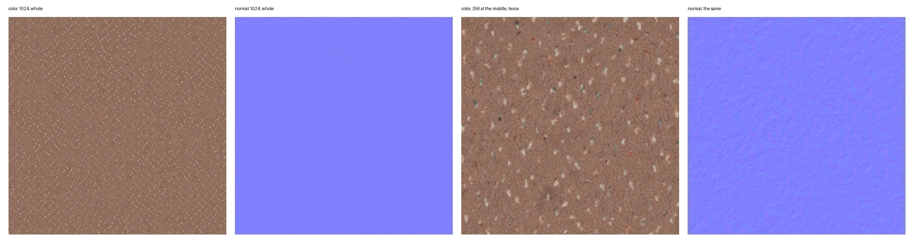
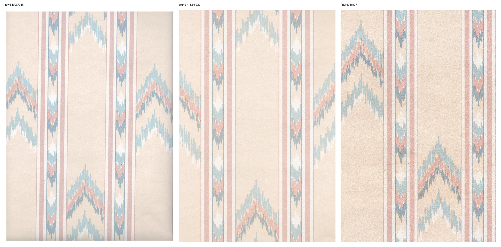
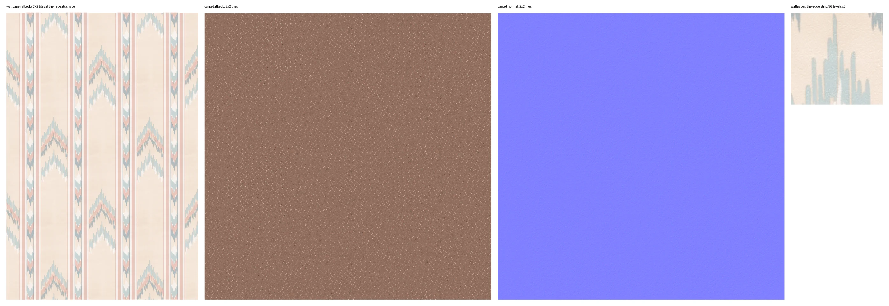

# Modeling devlog

What landed in Modeling, by day and newest first, with the pictures taken on the way, the captures
the repository keeps under `.github/assets` and the pictures made while an item was built, kept
under `.github/assets/readings` as WebP files named by their day, each on the day its name says, and
the notes written beside them as Markdown files named the same way. A line under Done names the item
of .github/REVIEW.md or .github/REVIEW-ARCHIVE.md and the commit that closed it.

## 2026-11-01

The carpet's 1K color and normal, whole and with the middle 256 texels enlarged twice, the normal's
slopes slight.

The wallpaper's three scans side by side at one height, the raw scan, scan2 turned straight and
cleaned, and the small final tile, none of them meeting itself at its edges.

The two sets decoded from their KTX2 files, the wallpaper's albedo tiled twice each way at its
repeat's shape of 17.7 by 26.4 cm, the carpet's albedo and normal tiled the same, and the strip at
the wallpaper tile's left edge halfway down enlarged three times, a place whose copies lie only at
the scan's edges.

Done that day

- Item 5 at `883d624`. Interior textures in the module's bounded collection.

## 2026-10-31

Done that day

- Item 1 at `a7da906`. The documents, one commit.
- Item 2 at `6fb25bb`. The skeleton, one commit after item 1.
